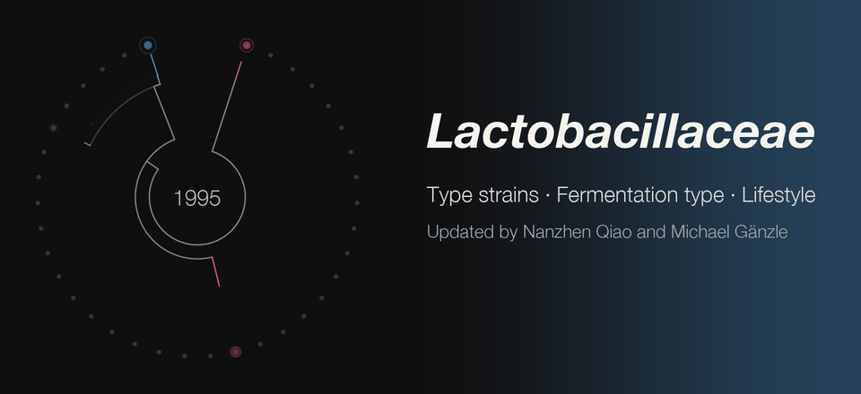

<picture><source media="(prefers-reduced-motion: reduce)" srcset="lactobacillaceae-banner-20261109.png"></picture>

38

genera currently placed in <em>Lactobacillaceae</em> family, updated on November 9, 2026.

18<strong>Homofermentative</strong>18 genera &middot; 47%

18<strong>Heterofermentative</strong>18 genera &middot; 47%

2<strong>Unassigned</strong>2 genera &middot; 5%

Homofermentative
Heterofermentative
Unassigned

<a href="lactobacillaceae-genera">All 38 genera</a> with type species, fermentation type, the year each was proposed, and their order on the tree.

👉

478

species and subspecies currently placed in <em>Lactobacillaceae</em> family (443 species, 35 subspecies), updated on November 11, 2026.

229<strong>Homofermentative</strong>229 species and subspecies &middot; 48%

207<strong>Heterofermentative</strong>207 species and subspecies &middot; 43%

42<strong>Not yet assessed</strong>42 species and subspecies &middot; 9%

Homofermentative
Heterofermentative
Not yet assessed

<a href="lactobacillaceae-species">All 478 species and subspecies</a> with type strains, genomes, publication DOIs, fermentation type and lifestyle.

👉

For detailed homofermentative and heterofermentative fermentation, check [Gänzle 2015](https://doi.org/10.1016/j.cofs.2015.03.001) and [Qiao & Gänzle 2026](https://doi.org/10.1016/j.fm.2025.104945). For detailed lifestyle updates, check [Duar et al. 2017](https://doi.org/10.1093/femsre/fux030), [Nanzhen Qiao](https://www.linkedin.com/in/nanzhen/) and [Michael Gänzle](https://scholar.google.com/citations?user=Zc29kvEAAAAJ&hl=en). To check how a former species name maps to its current one, use [LactoTax](https://www.lactobacillus.ualberta.ca/) and [Zheng et al. 2020](https://doi.org/10.1099/ijsem.0.004107).
