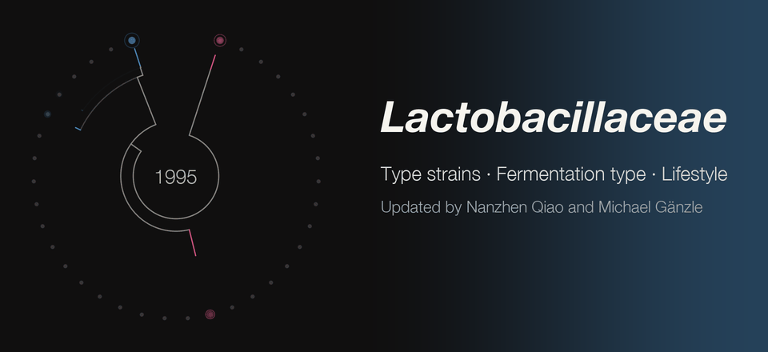

<a class="lacto-ask-fab" href="lactobacillaceae#ask" data-router-ignore data-endpoint="https://lactorador-api.onrender.com/api/ask" aria-expanded="false"><svg class="lacto-ask-icon" aria-hidden="true" viewBox="0 0 24 24" width="18" height="18"><rect x="0.5" y="9" width="11" height="6" rx="3" fill="currentColor"/><rect x="12.5" y="9" width="11" height="6" rx="3" fill="currentColor" opacity="0.7"/></svg>Ask <em>Lactobacillaceae</em>AI</a>

<picture><source media="(prefers-reduced-motion: reduce)" srcset="lactobacillaceae-banner-20261110.png"></picture>

<section class="lacto-sec">

38

genera currently placed in <em>Lactobacillaceae</em> family, updated on November 10, 2026.

19<strong>Homofermentative</strong>19 genera &middot; 50%

18<strong>Heterofermentative</strong>18 genera &middot; 47%

1<strong>Unassigned</strong>1 genera &middot; 3%

Homofermentative
Heterofermentative
Unassigned

<a class="lacto-go" href="lactobacillaceae-genera">View all 38 genera 👉</a>
</section>

<section class="lacto-sec">

477

species and subspecies currently placed in <em>Lactobacillaceae</em> family (442 species, 35 subspecies), updated on November 11, 2026.

247<strong>Homofermentative</strong>247 species and subspecies &middot; 52%

229<strong>Heterofermentative</strong>229 species and subspecies &middot; 48%

1<strong>Not yet assessed</strong>1 species and subspecies &middot; 0%

Homofermentative
Heterofermentative
Not yet assessed

<a class="lacto-go" href="lactobacillaceae-species">View all 477 species and subspecies 👉</a>
</section>

<section class="lacto-sec">

289

old names of lactobacilli and the name each one has now (281 are old <em>Lactobacillus</em> names), updated on November 23, 2026.

<strong role="cell">241</strong>got a new genus name; the species name stayede.g. <em>Lactobacillus casei</em> → <em>Lacticaseibacillus casei</em>

<strong role="cell">28</strong>got a new genus name and a different species or subspecies namee.g. <em>Lactobacillus cellobiosus</em> → <em>Limosilactobacillus fermentum</em>

<strong role="cell">12</strong>stayed in the same genus under another namee.g. <em>Lactobacillus bulgaricus</em> → <em>Lactobacillus delbrueckii</em> subsp. <em>bulgaricus</em>

<strong role="cell">6</strong>are no longer in <em>Lactobacillaceae</em>e.g. <em>Lactobacillus xylosus</em> → <em>Lactococcus lactis</em>

<strong role="cell">2</strong>have no valid name todaye.g. <em>Lactobacillus rogosae</em>

45 species and subspecies that were <em>Lactobacillus</em> before 2020 still are.

<form class="lacto-sec-find" action="lactobacillaceae-names" method="get" role="search">
<input type="search" name="q" placeholder="Enter an old species name" aria-label="Old species name" autocomplete="off" autocapitalize="off" spellcheck="false" required />
<button type="submit">Find the new name</button>
</form>
<a class="lacto-go" href="lactobacillaceae-names" data-router-ignore>View all 289 old names 👉</a>
</section>

For detailed homofermentative and heterofermentative fermentation, check [Gänzle 2015](https://doi.org/10.1016/j.cofs.2015.03.001) and [Qiao & Gänzle 2026](https://doi.org/10.1016/j.fm.2025.104945). For detailed lifestyle updates, check [Qiao 2025](https://doi.org/10.7939/83003) (PhD thesis, Ch. 6), with [Duar et al. 2017](https://doi.org/10.1093/femsre/fux030) for the original categories, [Nanzhen Qiao](https://www.linkedin.com/in/nanzhen/) and [Michael Gänzle](https://scholar.google.com/citations?user=Zc29kvEAAAAJ&hl=en).

If these lists help your work, please cite our work. For questions or corrections, connect with [Nanzhen Qiao on LinkedIn](https://www.linkedin.com/in/nanzhen/).

[🐝](#top)
